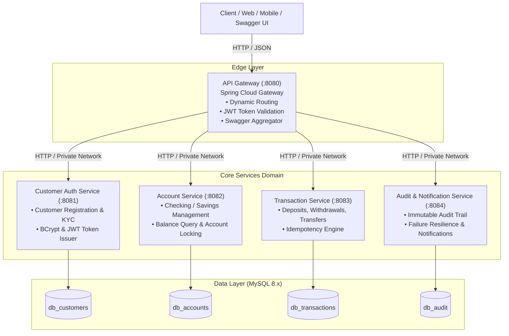
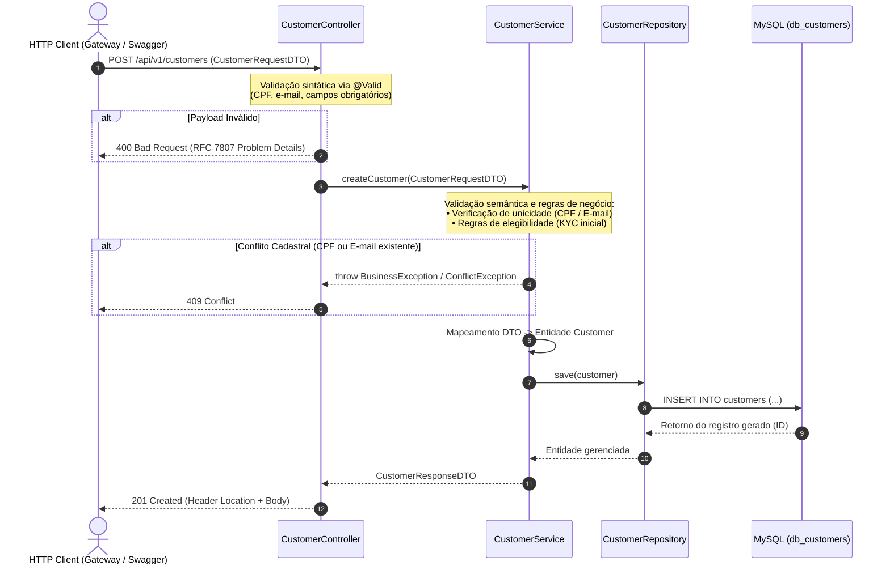

# Digital Bank Microservices

[](https://openjdk.org/)
[](https://spring.io/projects/spring-boot)
[](https://spring.io/projects/spring-cloud)
[](https://spring.io/projects/spring-security)
[](https://www.mysql.com/)
[](https://flywaydb.org/)
[](https://swagger.io/)
[](https://maven.apache.org/)

---

### Especificações Técnicas de Infraestrutura

| Parâmetro | Definição |
| :--- | :--- |
| **Padrão Arquitetural** | Microservices, Database-per-Service, Stateless Authentication, Centralized API Gateway |
| **Ambiente de Execução** | OpenJDK 21 LTS (64-bit) |
| **Framework Base** | Spring Boot 3.4.x / Spring Cloud 2024.x |
| **Camada de Persistência** | Spring Data JPA, Hibernate 6, MySQL 8.0+ |
| **Controle de Schemas** | Flyway Database Migrations (Versionado) |
| **Governança de APIs** | RESTful HTTP/JSON, OpenAPI 3.0 / Swagger, RFC 7807 (Problem Details) |
| **Estratégia de Concorrência** | Optimistic Locking (`@Version`), Isolamento Transacional ACID |

---

## Sumário

- [Visão Geral da Arquitetura](#visão-geral-da-arquitetura)
- [Catálogo de Microsserviços](#catálogo-de-microsserviços)
- [Padrões Arquiteturais e Conceitos Aplicados](#padrões-arquiteturais-e-conceitos-aplicados)
- [Fluxo de Execução: Customer Onboarding](#fluxo-de-execução-customer-onboarding)
- [Stack Tecnológica](#stack-tecnológica)
- [Estrutura do Repositório](#estrutura-do-repositório)
- [Configuração de Ambiente e Execução](#configuração-de-ambiente-e-execução)
- [Especificação de Contratos (API Contracts)](#especificação-de-contratos-api-contracts)
- [Status de Desenvolvimento e Backlog](#status-de-desenvolvimento-e-backlog)

---

## Visão Geral da Arquitetura

O sistema adota o padrão de microsserviços desacoplados, onde cada serviço possui seu próprio ciclo de deploy, runtime independente e esquema de banco de dados exclusivo.

As comunicações externas convergem para o **API Gateway**, responsável pelo roteamento dinâmico, terminação/validação de autenticação via JWT, aplicação de políticas de rate limiting/segurança e unificação da interface OpenAPI/Swagger.



---

## Catálogo de Microsserviços

| Microsserviço | Porta | Banco de Dados | Domínio e Responsabilidade | Tópicos Técnicos / Design Patterns |
| :--- | :---: | :---: | :--- | :--- |
| **`api-gateway`** | `8080` | — | Ponto único de entrada, roteamento reativo, validação de segurança e agregação Swagger. | Spring Cloud Gateway, Reactive Filters, Token Validation. |
| **`customer-auth-service`** | `8081` | `db_customers` | Ciclo de vida do cliente, processo de KYC básico, emissão e assinatura de tokens JWT. | Spring Security, BCrypt, Stateless JWT, Jakarta Validation. |
| **`account-service`** | `8082` | `db_accounts` | Gerenciamento de contas correntes/poupança, retenção de saldos e controle de bloqueios judiciais/cadastrais. | Optimistic/Pessimistic Locking (`@Version`), `BigDecimal`, Isolamento ACID. |
| **`transaction-service`** | `8083` | `db_transactions` | Execução de débitos, créditos, transferências (PIX/TED) e conciliação de extratos. | Idempotência (`Idempotency-Key`), Spring `RestClient` / `@HttpExchange`. |
| **`audit-notification-service`** | `8084` | `db_audit` | Registro em log estruturado e imutável para auditoria regulatória, alertas transacionais e tolerância a falhas. | Comunicação Inter-serviços, Dead Letter Queues / Resiliência. |

---

## Padrões Arquiteturais e Conceitos Aplicados

1. **Database-per-Service:** Nenhuma aplicação acessa diretamente tabelas de outro serviço. O compartilhamento de estado ocorre exclusivamente por contratos HTTP REST ou mensageria.
2. **Controle de Concorrência Transacional:** Operações de débito e crédito no `account-service` utilizam estratégias de bloqueio (otimista via `@Version` ou pessimista via `PESSIMISTIC_WRITE`) para evitar anomalias de *lost update* e *dirty read*.
3. **Idempotência em Pagamentos:** O `transaction-service` valida o cabeçalho `Idempotency-Key` para impedir duplicidade de ordens em cenários de timeout ou reenvios pelo cliente.
4. **Precisão Numérica Financeira:** Utilização estrita de `BigDecimal` com escala explícita para representação de moedas e taxas, prevenindo erros de ponto flutuante binário.
5. **Evolução de Schemas com Migrations:** Gerenciamento de DDL versionado via Flyway, garantindo reprodutibilidade do schema em qualquer ambiente.

---

## Fluxo de Execução: Customer Onboarding

A figura a seguir detalha o processamento síncrono interno da criação de um cliente (`customer-auth-service`), isolando as responsabilidades de cada camada:



---

## Stack Tecnológica

- **Linguagem:** Java 21 LTS
- **Framework Base:** Spring Boot 3.4.x
- **Camada Web:** Spring MVC / Spring Cloud Gateway
- **Acesso a Dados:** Spring Data JPA / Hibernate 6
- **Banco de Dados Relacional:** MySQL 8.0+
- **Versionamento de Schema:** Flyway 10+
- **Segurança e Criptografia:** Spring Security, BCrypt, JJWT (Java JWT)
- **Validação de Domínio:** Jakarta Validation 3.0 (Hibernate Validator)
- **Documentação de API:** SpringDoc OpenAPI 3 (Swagger UI)
- **Build & Dependências:** Apache Maven 3.9+
- **Boilerplate Reduction:** Project Lombok

---

## Estrutura do Repositório

```plaintext
digital-bank-microservices/
├── api-gateway/                      # [Em planejamento] Gateway central e filtros
├── customer-auth-service/            # [Fase 1] Serviço de cadastro e emissão de credenciais
│   ├── src/main/java/com/digitalbank/customer_auth_service/
│   │   ├── config/                   # Beans de infraestrutura, segurança e OpenAPI
│   │   ├── controller/               # Camada de endpoints REST
│   │   ├── dto/                      # Records / Classes de transferência de dados (Request/Response)
│   │   ├── exception/                # ControllerAdvice e handlers de erro globais
│   │   ├── model/                    # Entidades de domínio JPA e Enums
│   │   ├── repository/               # Repositórios Spring Data
│   │   └── service/                  # Regras de negócio, transações e validações KYC
│   └── src/main/resources/
│       ├── db/migration/             # Scripts versionados de DDL do Flyway
│       └── application.yaml          # Configurações de datasource, JPA e servidor
├── account-service/                  # [Em planejamento] Contas bancárias e limites
├── transaction-service/              # [Em planejamento] Movimentações, PIX e TED
└── audit-notification-service/       # [Em planejamento] Logs imutáveis e mensageria
```

---

## Configuração de Ambiente e Execução

### Pré-requisitos

1. **Java Development Kit (JDK) 21** instalado.
2. **MySQL Server 8.0+** ativo na porta `3306`.
3. Ferramenta de linha de comando ou cliente SQL para preparação dos schemas.

### 1. Inicialização dos Bancos de Dados

Antes de iniciar os microsserviços, garanta a existência dos esquemas de dados isolados:

```sql
CREATE DATABASE IF NOT EXISTS db_customers CHARACTER SET utf8mb4 COLLATE utf8mb4_unicode_ci;
CREATE DATABASE IF NOT EXISTS db_accounts CHARACTER SET utf8mb4 COLLATE utf8mb4_unicode_ci;
CREATE DATABASE IF NOT EXISTS db_transactions CHARACTER SET utf8mb4 COLLATE utf8mb4_unicode_ci;
CREATE DATABASE IF NOT EXISTS db_audit CHARACTER SET utf8mb4 COLLATE utf8mb4_unicode_ci;
```

### 2. Configurações de Conexão (`customer-auth-service`)

O arquivo `src/main/resources/application.yaml` gerencia o datasource e o comportamento do Hibernate:

```yaml
server:
  port: 8081

spring:
  application:
    name: customer-auth-service
  datasource:
    url: jdbc:mysql://localhost:3306/db_customers?useSSL=false&serverTimezone=America/Sao_Paulo&allowPublicKeyRetrieval=true
    username: ${DB_USER:root}
    password: ${DB_PASSWORD:sua_senha}
    driver-class-name: com.mysql.cj.jdbc.Driver
  jpa:
    open-in-view: false
    hibernate:
      ddl-auto: validate
    show-sql: false
  flyway:
    enabled: true
    locations: classpath:db/migration
```

### 3. Build e Inicialização

```bash
# Navegar até o diretório do serviço
cd digital-bank-microservices/customer-auth-service

# Executar migrações do Flyway e iniciar aplicação
./mvnw spring-boot:run
```

Para ambientes Windows PowerShell / CMD:
```powershell
.\mvnw.cmd spring-boot:run
```

A documentação interativa estará acessível via navegador em:
`http://localhost:8081/swagger-ui.html`

---

## Especificação de Contratos (API Contracts)

### `customer-auth-service`

#### Cadastro de Novo Cliente
- **Método:** `POST`
- **Caminho:** `/api/v1/customers`
- **Cabeçalhos:** `Content-Type: application/json`

**Payload de Requisição:**
```json
{
  "fullName": "Carlos Silva",
  "cpf": "12345678901",
  "email": "carlos.silva@example.com",
  "phone": "+5511999998888",
  "birthDate": "1990-05-15"
}
```

**Resposta de Sucesso (`201 Created`):**
```json
{
  "id": 1,
  "fullName": "Carlos Silva",
  "cpf": "12345678901",
  "email": "carlos.silva@example.com",
  "phone": "+5511999998888",
  "birthDate": "1990-05-15",
  "status": "PENDING",
  "createdAt": "2026-11-25T12:00:00.000000"
}
```

**Respostas de Erro Padronizadas (RFC 7807):**
```json
{
  "type": "about:blank",
  "title": "Validation Failure",
  "status": 400,
  "detail": "Um ou mais campos contêm valores inválidos.",
  "errors": [
    {
      "field": "cpf",
      "message": "CPF deve conter 11 dígitos válidos."
    }
  ]
}
```

---

## Status de Desenvolvimento e Backlog

### Fase 1: `customer-auth-service`
- [x] Configuração base do Spring Boot e plugin do Flyway
- [x] DDL inicial de persistência (`V1__create_customers_table.sql`)
- [x] Mapeamento ORM da entidade `Customer` e enum `CustomerStatus`
- [ ] Implementação do `CustomerRepository` com queries de existência
- [ ] Construção dos DTOs com validações `@NotBlank`, `@CPF`, `@Email`
- [ ] Camada de serviço `CustomerService` com validações de unicidade e regras de negócio
- [ ] `CustomerController` com suporte ao contrato REST e cabeçalho `Location`
- [ ] Handler global de exceções (`@RestControllerAdvice`)
- [ ] Integração com Spring Security e geração de Token JWT (HMAC / RSA)

### Fase 2: `account-service`
- [ ] Modelagem de contas (Corrente, Poupança, Saldo)
- [ ] Controle de concorrência com `@Version` (Optimistic Locking)
- [ ] Operações de consulta de extrato e atualização de saldo sob transação ACID

### Fase 3: `transaction-service`
- [ ] Fluxo de operações financeiras (PIX, TED, Saque, Depósito)
- [ ] Middleware/Filtro para verificação de `Idempotency-Key`
- [ ] Comunicação segura com `account-service` via HTTP Client

### Fase 4: `audit-notification-service`
- [ ] Criação do repositório de trilha imutável
- [ ] Mecanismo de notificação e tolerância a falhas

### Fase 5: `api-gateway`
- [ ] Configuração de rotas no Spring Cloud Gateway
- [ ] Validador global de assinaturas JWT no Gateway
- [ ] Agregação de documentação OpenAPI de todos os microsserviços
